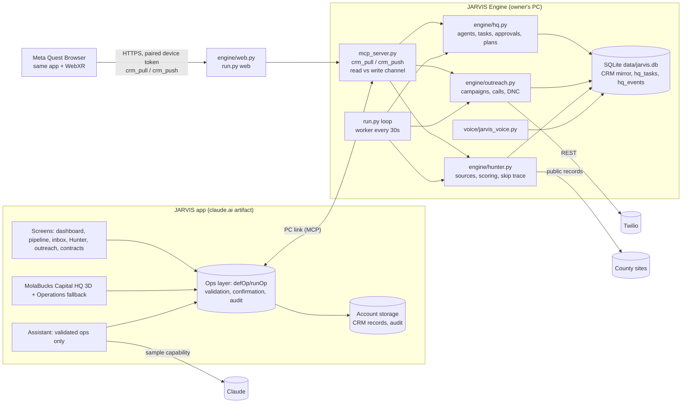

# MolaBucks Capital HQ — Architecture, status and roadmap

MolaBucks Capital HQ is a real estate wholesaling operating system with two halves:

- **JARVIS** is the app. It's a single-page web app published as a claude.ai artifact. It holds the CRM, the screens, the walkable 3D headquarters, the assistant, and approvals.
- **JARVIS Engine** is this repository. It's a Python and SQLite service on the owner's Windows PC. It runs the agents' task queue, the background worker, county record sourcing, skip-trace import/export, texting and calling through Twilio, and desktop voice.

The two halves talk over the **PC link**: a local MCP server (`mcp_server.py`) that the Claude desktop app exposes to the JARVIS page. For the Meta Quest (VR) and other browsers on your network, `run.py web` serves the same page and the same two sync tools over HTTPS to paired devices (see VR.md).

This document is the audit baseline required by the master build prompt. Wherever this document says something works, a test in the Tests section covers it.

## System diagram

## Layers and where they live

| Layer | Where | Notes |
|---|---|---|
| Experience | App: `src/07e-hq.js` (panels, Operations view), `src/07f-hq3d.js` (3D engine, HUD), `src/07g-hqxr.js` (WebXR: Quest session, locomotion, world-space panels), other `src/*.js` screens | The 3D view is optional. Every action is also in the Operations view and the regular screens. VR panels call the same ops; confirmations route to the headset. |
| Application | App: `src/03-ops.js` and feature files | Each write is a `defOp` with validation, a role check (`permissionGap`), confirmation for consequential actions, an idempotency key and an audit entry. |
| Agent | Engine: `engine/hq.py` (`AGENTS`, `KINDS`, executors, planner) | Each task type belongs to one agent and has a policy level (1 internal, 2 draft, 3 outside commitment). |
| Execution | Engine: `run.py` loop → `hq.tick` → `run_due` | The work queue is durable and survives restarts. It uses leases, a dependency check, retry with backoff, permanent-failure recovery notes, stale-lease recovery, and a global pause. |
| Integration | Engine: `engine/outreach.py` (Twilio), `engine/hunter.py` and adapters (county records, AvaData CSV), `engine/ai.py` (Anthropic) | Integrations that aren't configured say so (for example, "Twilio not configured"). Nothing is reported as sent without a provider response. |
| Network access | Engine: `engine/web.py` (`run.py web`) | Serves the app plus `crm_pull`/`crm_push`/`list_counties` over HTTPS with a self-signed certificate. Devices pair with a 6-digit code from the PC; only token hashes are stored. |
| Persistence | Engine: SQLite `data/jarvis.db`. App: per-account artifact storage | CRM records sync both ways; the newest `_ts` wins. HQ tasks and events live only in the engine. |
| Observability | `hq_events` (every state change), `hq.health()` (loop heartbeat, queue depth, leases, pause), app Activity log | HQ shows the sync age and a "work loop isn't running" alert. |

## State and event model

1. A task row moves through these states: queued → running (leased) → completed (verified), blocked (result unverifiable), or failed. Along the way it can also be waiting (on a dependency or a retry backoff), awaiting_approval, cancelled or rejected.
2. Every transition writes an `hq_events` row. The app polls `hq.state` every 5 seconds while HQ is open. In the app:
   - The 3D world, the HUD and the event feed are diffs between real snapshots.
   - Agent animations read the task state; there are no timers.
   - "Done" means the executor verified the result against the database.
3. Approvals happen on the backend:
   - A level-3 task can't be leased unless `approved_hash == params_hash`, so editing it after approval sends it back to the approval tray.
   - Approvals travel only on the write channel (`crm_push`), and only the owner or a manager can send them.
   - The read channel (`crm_pull`) refuses every write operation.
4. Global pause: `hq.paused()` is true when the owner paused HQ or the CRM emergency stop is on. While paused:
   - The worker starts nothing and the scheduler creates nothing.
   - "Run now" is refused.
   - A task already running finishes, because the worker is single-threaded.

## Audit: what works today

- **The agents' task system:**
  - Durable queue, dedupe keys, dependencies, leases, recovery and retries.
  - Hash-bound approvals, scheduled morning briefing and end-of-day review, goal → plan → today's tasks.
  - Truthful agent states, global pause, a "while you were away" report and worker health.
- **The agents' work** (executors use real records):
  - Hunter: syncs sources, ranks the top leads, reviews the backlog.
  - Closer: reviews the pipeline for blockers.
  - Dispositions: matches buyers on stored criteria.
  - Follow-up: lists who's due, checks campaign health, launches campaigns (level 3).
  - Front Desk: triages messages.
  - Finance: realized vs. projected fees, EMD and closing deadlines, and the Twilio balance only when Twilio reports it.
- **CRM:**
  - Pipeline with 8 stages (kept as they are) and a 23-step acquisition track.
  - Offers with scenario math, an approval queue, and the Closer handoff checklist.
  - Contracts with evidence-gated status changes.
  - Comps rules, a configurable MAO % (70% is a stated assumption), and a photo rehab estimator that is labeled preliminary.
  - Roles and permissions.
- **Outreach:** campaigns and drips gated on consent, Do Not Contact, quiet hours, delivery states from Twilio, dialer, numbers, and usage.
- **HQ v2:**
  - First-person 3D with collision, a minimap, compass, objectives, live event feed, fast travel, immersive mode, quality presets and day/night.
  - Every object opens a real panel. There's an Operations (2D) fallback.

## Gaps against the master prompt (ranked)

1. **Unattended operation needs the PC to stay on.** The worker runs inside `run.py` on the owner's PC; when the PC sleeps, the agents stop. Real 24/7 operation means running the engine on an always-on host: a small VPS or mini-PC with `run.py` as a service, the same SQLite file, and the PC link replaced by an authenticated HTTPS endpoint. This is the main deployment decision.
2. **Reassigning tasks:** each task type maps to exactly one capable agent today, so there's nothing to reassign to. This needs capability-based routing once two agents share a capability.
3. **Business intelligence:** conversion rates, cycle time, follow-up completion rate and cost/net-profit tracking (no cost records exist yet). Finance currently separates realized from projected only.
4. **The meeting room** shows reports but can't record decisions or turn them into tasks.
5. **Recommendation feedback loop** (comparing a plan's predictions with actual results): not started.
6. **An agent registry in the app:** the agent list is hard-coded in `07e-hq.js`. It should come from `hq.state().agents` so adding an agent in the engine is enough.
7. **Property-data provider** (comps and ARV): not connected. Comps come from CSV files the owner adds, and nothing is invented.
8. **VR on a physical headset:** WebXR mode is built (session, locomotion, panels, approvals) and passes a Quest 2 emulator test, but it hasn't run on a real Quest 2 yet. Frame rate and comfort are unmeasured.
9. **Notifications outside the app** (push or email) for approvals and failures.

## Tests

- **Engine:**
  - `python -m tests.test_hq`: lifecycle, dedupe, leases, recovery, retries, blockers, approvals (including approvals voided by edits), plan, schedule, truthful states, the bridge channels, pause, emergency stop, the away report and health.
  - `python -m tests.test_outreach` and `python -m tests.test_hunter`.
- **Web/VR server:** `python -m tests.test_web` (pairing, tokens, lockout, allowlist, read channel, revoke).
- **VR end to end** (Playwright + IWER Quest 2 emulator + a real `run.py web` server): pairing, Enter VR, locomotion, snap turn, collision, menu, panels, agent tasks, approval with confirmation, stage move, network drop, exit. 48 checks; listed in VR.md.
- **App** (jsdom against the real engine through a bridge):
  - `node test/hq.js` (27 checks): Operations fallback, assign, talk → task, approvals, goal → plan, reports, queue, task detail, pause/resume enforced by the engine, live feed, the away report and roles.
  - `node test/outreach.js` (30 checks) and the other `test/*.js` suites.

## Demo script (about 5 minutes)

1. **Open HQ and press Enter HQ.** Point out the live sync pill and that agent states come from the engine.
2. **Walk to the Approval station**, open a level-3 task, and show that it can't run until approved. Approve it, and the HUD feed shows it start.
3. **Set a goal with JARVIS.** JARVIS builds the plan from realized fees, the plan wall updates, and today's tasks appear in the queue.
4. **Close the app.** On the PC the loop keeps running tasks. Reopen JARVIS: the "While you were away" report lists verified completions, failures and approvals.
5. **Pause automation from JARVIS.** Show "Run now" being refused and the feed wall logging the pause. Resume.
6. **Switch to the Operations view** to show that the 3D view isn't required for anything.

## Roadmap (phases from the master prompt)

| Phase | Status |
|---|---|
| 0 Audit and baseline | Done (this document plus the test suites) |
| 1 Operating foundation | Done, including the pause and health added in this round. Open: hosted worker for 24/7 operation. |
| 2 Immersive HQ | Done (v2). Open: meeting-room decisions, a dedicated BI wall. |
| 3 JARVIS orchestration | Partial: goal → plan → daily tasks → briefing and end-of-day review. Open: free-form objective decomposition through the model with validated task output. |
| 4 Specialized agents | Partial: real executors for all six. Open: drafting outreach as level-2 tasks, and the Front Desk creating records from inbound messages. |
| 5 Integrations | Twilio live (needs funds, a number and A2P registration). Property data: not connected. |
| 6 BI and optimization | Not started beyond realized vs. projected. |
| 7 Voice | Desktop voice works with read tools. Open: voice creating HQ tasks through the same ops. |
| 8 VR | Built for Meta Quest 2 and verified in an emulator. Untested on a physical headset (see VR.md for the checklist). |
| 9 Hardening and deployment | Partial. Open: always-on host, backups, alerting. |
